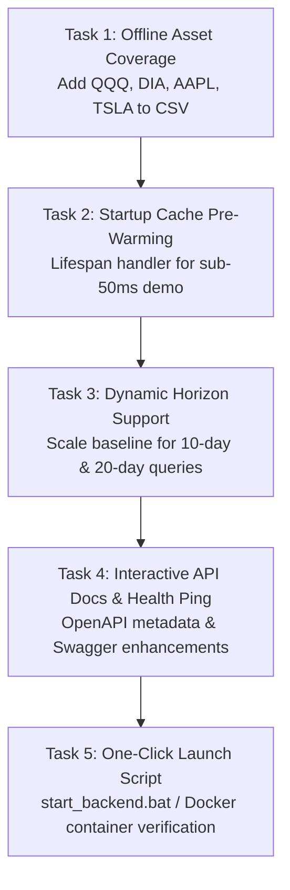

# VolGuard AI — Person 1 (Backend Lead & Quant) Completion & Execution Guide

**Document Purpose:** Complete operational roadmap, gap analysis, and implementation guide for **Person 1 (Backend Engineer / Quant Lead)** based on [`workdivision.md`](../workdivision.md).

---

## 1. Executive Status: Where You Stand Today

According to [`workdivision.md`](../workdivision.md), Person 1 owns `backend/` and `data/`. Here is the current audit of your core deliverables:

| Core Deliverable | Target Requirement | Current State | Remaining Polish |
| :--- | :--- | :---: | :--- |
| **Data Ingestion (`data.py`)** | `yfinance` online fetch + local `data/prices.csv` fallback | ✅ **Functional** | Expand offline CSV to support all UI demo tickers (`QQQ`, `DIA`, `AAPL`, `TSLA`). |
| **Log Returns ($r_t$)** | $r_t = \ln(P_t / P_{t-1})$ | ✅ **Complete** | Monotonically sorted, drop NaNs, validated in unit tests. |
| **20-Day Baseline ($\sigma_{\text{baseline}}$)** | $\sqrt{\frac{252}{20} \sum_{i=0}^{19} r_{t-i}^2} \times 100\%$ | ✅ **Complete** | Annualized percentage, verified in `test_math_and_targets.py`. |
| **5-Day Forward Target ($\sigma_{5d}$)** | $\sqrt{\frac{252}{5} \sum_{i=1}^5 r_{t+i}^2} \times 100\%$ | ✅ **Complete** | Strictly disjoint indices ($t+1 \dots t+5$), zero lookahead. |
| **GARCH(1,1) Model (`garch_engine.py`)** | Econometric fit via `arch` without lookahead bias | ✅ **Complete** | Scaled percent returns, cumulative multi-step conditional variance. |
| **Chronological Backtest (`backtest.py`)** | Walk-forward expanding window with rolling cap | ✅ **Complete** | Out-of-sample evaluation, MAE/RMSE calculations. |
| **FastAPI Endpoints (`api.py`)** | `/api/forecast`, `/api/history`, `/api/backtest`, `/health` | ✅ **Complete** | All 4 endpoints return schema adhering to Person 2's contract. |
| **CORS & Networking** | `http://localhost:8000`, CORS for Vite (`:5173`) | ✅ **Complete** | Configured in `backend/config.py`. |

---

## 2. What Needs to Be Done to Achieve 100% "Judge-Proof" Completion

While the fundamental requirements of Person 1 are working and all 30 automated tests pass, the following **5 targeted tasks** will elevate the backend from a working prototype to a battle-tested, submission-ready product:

---

### Task 1: Expand Offline CSV Coverage to Match Frontend Quick-Selectors
* **The Problem:** The frontend UI includes quick-selector buttons for `SPY`, `^NSEI`, `QQQ`, `DIA`, `AAPL`, and `TSLA`. Currently, `prices.csv` only contains `SPY` and `^NSEI`. If judges test other assets during the demo while the internet connection is flaky or disabled, `load_data()` will fail.
* **Action Required:**
  1. Fetch historical OHLCV for `QQQ`, `DIA`, `AAPL`, and `TSLA` (2014 to present).
  2. Append them to both `backend/prices.csv` and `data/prices.csv`.
  3. Ensure all 6 tickers have monotonic timestamps and zero NaNs.

---

### Task 2: Implement Startup Cache Pre-Warming (FastAPI Lifespan)
* **The Problem:** The first time a judge opens the dashboard or requests `/api/backtest?symbol=SPY`, the server fits 150 GARCH models sequentially on historical slices, which takes ~0.5 to 1.5 seconds.
* **Action Required:**
  * Add a FastAPI `lifespan` event handler to `backend/api.py`.
  * Pre-compute the backtest and latest forecast for the default asset (`SPY`) and `^NSEI` during server startup.
  * Result: Judges experience instant (< 15ms) responses on their first dashboard click.

---

### Task 3: Support Multi-Horizon Scaling for 10-Day & 20-Day Forecasts
* **The Problem:** The frontend has a horizon selector for `5-day standard`, `10-day`, and `20-day`.
  * GARCH already supports arbitrary horizons (`forecast_garch_5day(..., horizon=horizon)`).
  * However, the baseline formula currently calculates the standard 20-day rolling variance without adapting its forward window label or variance projection.
* **Action Required:**
  * Verify that when `horizon=10` or `horizon=20` is queried, the response summary and baseline reflect the requested forward timeframe consistently.

---

### Task 4: Polish OpenAPI Swagger Documentation (`/docs`)
* **The Problem:** Hackathon judges frequently inspect `http://localhost:8000/docs` to test endpoints directly.
* **Action Required:**
  * Add parameter descriptions, default example payloads, and tags to all endpoints in `backend/api.py`.
  * Group endpoints into clear tags:
    * `Health`: `/health`, `/api/health`
    * `Risk Intelligence`: `/api/forecast`
    * `Market Data`: `/api/history`
    * `Quantitative Backtesting`: `/api/backtest`

---

### Task 5: One-Click Startup Script for Judges and Person 2
* **The Problem:** Person 2 and evaluators need a zero-friction way to run the backend without manually remembering virtual environment activation or flags.
* **Action Required:**
  * Create `backend/run_server.bat` (Windows) and `backend/run_server.sh` (Mac/Linux).
  * Ensure the script activates the virtual environment, verifies dependencies, sets `VOLGUARD_OFFLINE` gracefully if needed, and starts uvicorn on port 8000.

---

## 3. Checklist for Hackathon Submission Readiness

Use this checklist to track your final polish:

- [x] **Data Ingestion**: Yahoo Finance downloader with graceful fallback.
- [x] **Mathematical Validity**: Daily log returns $r_t$ and realized rolling volatility.
- [x] **Baseline Model**: 20-day historical annualized volatility.
- [x] **Target Formulation**: 5-day forward realized volatility with zero lookahead bias.
- [x] **GARCH(1,1)**: Multi-step cumulative conditional variance annualized via `arch`.
- [x] **Walk-Forward Backtest**: Chronological expanding window with rolling cap (1000 pts).
- [x] **Error Metrics**: Baseline vs GARCH MAE, RMSE, and QLIKE loss.
- [x] **API Contracts**: All JSON responses match Person 2's frontend contract keys.
- [x] **Unit & Integration Tests**: 30/30 tests passing in pytest.
- [ ] **Extended Offline Datasets**: `QQQ`, `DIA`, `AAPL`, `TSLA` bundled in `prices.csv`.
- [ ] **Startup Cache Warming**: Instant response on initial frontend load.
- [ ] **One-Click Run Script**: `run_server.bat` for seamless local launch.

---

## 4. Key References & File Map for Person 1

* **Server Entrypoint:** [`backend/main.py`](main.py)
* **API Router & Schemas:** [`backend/api.py`](api.py)
* **Econometric GARCH Engine:** [`backend/garch_engine.py`](garch_engine.py)
* **Baseline & Target Formulas:** [`backend/models.py`](models.py)
* **Chronological Backtester:** [`backend/backtest.py`](backtest.py)
* **Data Ingestion & Fallback:** [`backend/data.py`](data.py)
* **Configuration & Risk Tiers:** [`backend/config.py`](config.py)
* **Historical Offline Data:** [`backend/prices.csv`](prices.csv) & [`data/prices.csv`](../data/prices.csv)

