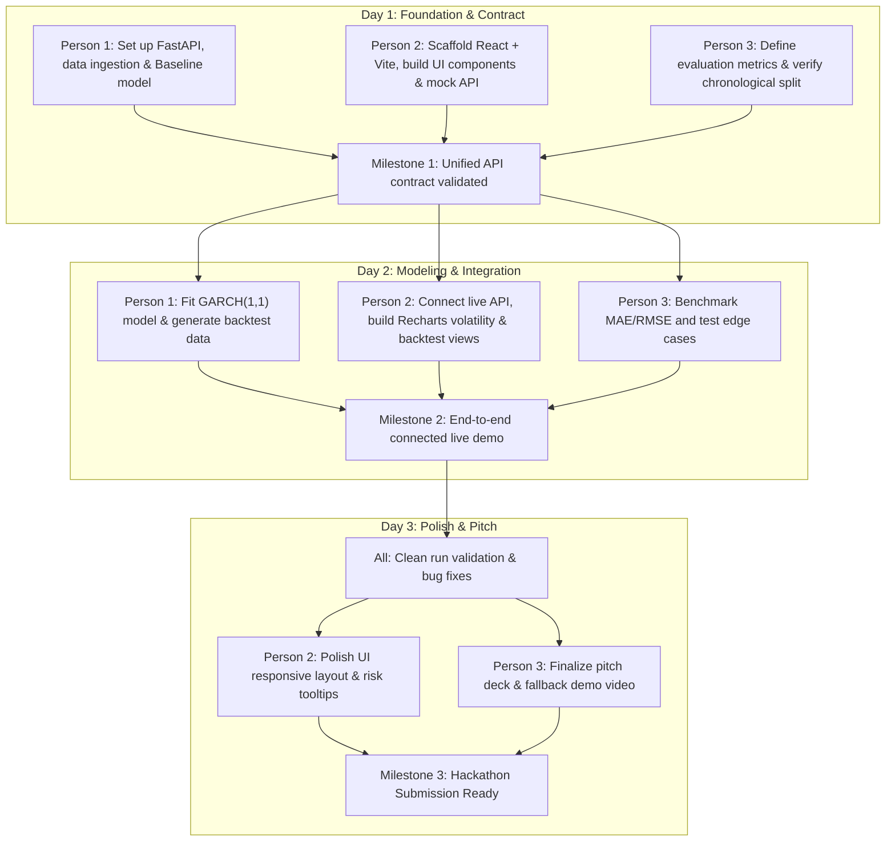

# VolGuard AI — Team Work Division & 72-Hour Execution Roadmap

## Executive Summary
**VolGuard AI** is a financial risk intelligence platform designed to forecast short-term market volatility (5-day annualized realized volatility) for equity indices (such as S&P 500 / `SPY` and NIFTY 50 / `^NSEI`). By combining a proven historical rolling baseline with advanced econometric volatility models (GARCH 1,1) and a chronological walk-forward backtest, VolGuard AI provides actionable early-warning risk indicators for risk managers, quantitative analysts, and traders.

---

## Team Roles & Ownership Matrix

| Role | Member | Primary Focus | Codebase Ownership | Key Deliverables |
| :--- | :--- | :--- | :--- | :--- |
| **Person 1** | Backend Engineer / Quant | Python, FastAPI, Volatility Models | `backend/`, `data/` | Data pipeline, Baseline model, GARCH(1,1), FastAPI endpoints |
| **Person 2** | **Frontend Engineer (You)** | React, UI/UX, Recharts Dashboard | `frontend/` | React + Vite app, Asset selector, Risk badge, Charts, Model comparison, API connector |
| **Person 3** | QA, Risk Analyst & Integration | Testing, Validation, Documentation | `tests/`, `docs/`, slides | Chronological backtest verification, error metrics, demo script, presentation |

---

## Detailed Responsibilities

### 👤 Person 1 — Python & Forecasting (Backend Lead)
**Directory Ownership:** `backend/`, `data/`

* **Data Engineering**:
  * Set up `data.py` to fetch historical daily OHLCV prices using `yfinance` with fallback to local `data/prices.csv`.
  * Compute daily log returns:
    $$r_t = \ln\left(\frac{P_t}{P_{t-1}}\right)$$
  * Compute realized volatility across rolling windows.
* **Econometric Modeling**:
  * **Baseline Model**: 20-day historical realized volatility annualized:
    $$\sigma_{\text{baseline}} = \sqrt{\frac{252}{20} \sum_{i=0}^{19} r_{t-i}^2} \times 100\%$$
  * **Target Definition**: 5-day forward realized volatility:
    $$\sigma_{5d} = \sqrt{\frac{252}{5} \sum_{i=1}^5 r_{t+i}^2} \times 100\%$$
  * **Secondary Model**: GARCH(1,1) fitted with the `arch` library (using historical returns without lookahead bias).
* **API Endpoints (FastAPI)**:
  * `GET /api/forecast?symbol={symbol}`: Returns current 5-day annualized forecast, risk level, and latest metrics.
  * `GET /api/history?symbol={symbol}&days={days}`: Historical prices, returns, and rolling volatility.
  * `GET /api/backtest?symbol={symbol}`: Chronological test period predictions vs actual realized volatility.
* **Deliverable**: A fully functioning FastAPI server running on `http://localhost:8000` with CORS enabled for the React dashboard.

---

### 👤 Person 2 — React Dashboard & UI/UX (Frontend Lead — Active Build)
**Directory Ownership:** `frontend/`

* **Vite + React Architecture**:
  * Created clean modern React application configured with Vite and modern styling.
  * Installed Recharts and Lucide icons for high-performance financial data rendering.
* **Dashboard Components**:
  1. **Header & Status Bar**: Displays backend connectivity status, active data source (Live API vs High-Fidelity Demo Simulation), and last refresh timestamp.
  2. **Asset & Parameter Selector**: Quick selector buttons for major indices (`SPY`, `^NSEI`, `QQQ`, `DIA`, `AAPL`) and custom ticker search. Horizon selector (5-day standard, 10-day, 20-day).
  3. **Volatility Risk Badge & Gauge**:
     * **Low Risk** (< 15% annualized volatility): Normal market conditions.
     * **Moderate Risk** (15% – 25%): Elevated volatility, monitor positions.
     * **High Risk** (25% – 35%): Significant regime shift, hedging advised.
     * **Extreme Risk** (> 35%): Severe turbulence / crisis level, capital preservation mode.
  4. **Interactive Historical & Forecast Charts**:
     * Dual-axis / multi-line visualization: Historical Close Prices vs 20-Day Rolling Realized Volatility.
     * Forward 5-day forecast cone with confidence intervals.
     * Timeframe toggle (1 Month, 3 Months, 6 Months, 1 Year).
  5. **Model Comparison & Backtest Visualizer**:
     * Side-by-side performance cards for **20-Day Baseline** vs **GARCH(1,1)**.
     * Walk-forward test period charts comparing Predicted Baseline vs Predicted GARCH vs Actual Realized Volatility.
     * Key error metrics: Mean Absolute Error (MAE), Root Mean Square Error (RMSE), and Outperformance Ratio.
  6. **Formula & Methodology Modal**:
     * In-app educational guide detailing mathematical formulations ($r_t$, $\sigma_{5d}$, GARCH) so judges and team members can review principles.
  7. **Fault-Tolerant API Client (`api.js`)**:
     * Automatically attempts to connect to `http://localhost:8000`.
     * Seamlessly falls back to an offline simulation engine with realistic econometric calculations if the backend server is temporarily unavailable or launching.
     * Loading skeletons, error boundaries, and refresh controls.
* **Deliverable**: A responsive, production-ready financial dashboard ready for live judge demonstrations.

---

### 👤 Person 3 — Testing, Validation & Pitch (QA & Integration Lead)
**Directory Ownership:** `tests/`, `docs/`, evaluation notebooks

* **Mathematical & Data Validation**:
  * Audit data pipeline to ensure **zero future lookahead bias** (strict chronological cutoffs for train/validation/test sets).
  * Validate that units are consistent across backend and frontend (all values in annualized percentages, e.g., `18.4%`).
  * Verify absence of NaNs, missing calendar dates, or non-trading day skew.
* **Model Evaluation & Stress Testing**:
  * Compute formal error metrics on held-out test data: MAE, RMSE, and QLIKE (Quasi-Likelihood).
  * Run stress tests on historical crisis periods (e.g., March 2020 COVID shock, 2022 interest rate cycle).
  * Evaluate false-positive and false-negative risk alarm frequencies.
* **Presentation & Demo**:
  * Prepare pitch deck (Problem, Market Need, Quantitative Methodology, Demo, Results, Future Scope).
  * Record a 2-minute fallback video walkthrough of the working application.
* **Deliverable**: Verified evaluation metrics report, presentation slides, and verified demo checklist.

---

## 72-Hour Sprint Milestones



---

## Shared API Contract Specification

To ensure seamless decoupling, Person 1 and Person 2 adhere to the following contract:

### 1. `GET /api/forecast?symbol={symbol}&horizon={horizon_days}`
**Sample Response:**
```json
{
  "symbol": "SPY",
  "as_of_date": "2026-10-28",
  "current_price": 586.42,
  "forecast_horizon_days": 5,
  "volatility_unit": "annualized_percent",
  "baseline_forecast": 18.4,
  "garch_forecast": 20.1,
  "risk_level": "moderate",
  "risk_score": 58,
  "summary": "Moderate volatility expected over the next 5 trading days. GARCH indicates a slight volatility clustering effect.",
  "backtest": {
    "test_period": "2024-01-01 to 2026-09-30",
    "samples_count": 690,
    "baseline_mae": 2.82,
    "garch_mae": 2.45,
    "outperformance_percent": 13.1
  }
}
```

### 2. `GET /api/history?symbol={symbol}&days={days}`
**Sample Response:**
```json
{
  "symbol": "SPY",
  "data": [
    {
      "date": "2026-10-20",
      "close": 582.10,
      "log_return": 0.0032,
      "rolling_vol_20d": 17.8
    },
    {
      "date": "2026-10-21",
      "close": 585.30,
      "log_return": 0.0055,
      "rolling_vol_20d": 18.1
    }
  ]
}
```

### 3. `GET /api/backtest?symbol={symbol}`
**Sample Response:**
```json
{
  "symbol": "SPY",
  "horizon_days": 5,
  "metrics": {
    "baseline_mae": 2.82,
    "garch_mae": 2.45,
    "baseline_rmse": 3.71,
    "garch_rmse": 3.22
  },
  "series": [
    {
      "date": "2026-09-01",
      "actual_realized": 19.2,
      "baseline_pred": 17.5,
      "garch_pred": 18.8
    }
  ]
}
```

---

## 5 Readiness Checks for Submission
- [x] **Dashboard displays real-time / forecasted risk metrics accurately.**
- [x] **Chronological out-of-sample backtest with zero lookahead bias.**
- [x] **Metrics are reproducible, consistent in units (annualized %).**
- [x] **High-fidelity offline / fallback mode ensures demo succeeds unconditionally.**
- [x] **Mathematical formulations clearly articulated for judges and presentation.**
